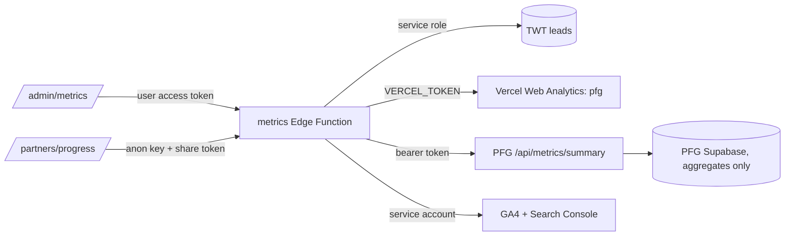

# METRICS DASHBOARD

Progress dashboard for both businesses, Tale Waters and Tides (consulting and the guide service) and Pocket Fishing Guide, kept in the site's admin pages, with a read-only partner view.

| | |
|---|---|
| Admin page | `/admin/metrics/` (magic-link sign-in, allowlisted emails) |
| Partner page | `/partners/progress/#t=<token>` (one link per partner, revocable) |
| Data service | Supabase Edge Function `metrics` ([README](../supabase/functions/metrics/README.md)) |
| Status | Code on branch `feat/metrics-dashboard`. Not deployed; secrets not set. |

---

## Goal

One place that shows how both businesses are moving, week by week, with a plain-language line under each chart that says what the numbers mean. The owner uses it weekly; partners get a trimmed view to see progress without seeing anyone's data.

Out of scope for this slice: editing leads, CRM workflows, revenue, and anything person-level.

---

## What it shows

| Business | Measure | Source | Partner view |
|----------|---------|--------|--------------|
| PFG | Visitors and pageviews per week, pages per visitor | Vercel Web Analytics | Yes |
| PFG | Where visitors come from (referrers, grouped) | Vercel Web Analytics | Yes |
| PFG | Accounts, new in 30 days, signed in last 7 days, signups per week | PFG app endpoint | Yes |
| PFG | Guide-trip requests and confirmations, published partners | PFG app endpoint | Yes |
| TWT | Sessions per week and channel | Google Analytics 4 | Yes |
| TWT | Leads per week, page and channel, where each lead stands, leads not yet worked | `leads` table | No |
| Both | Google clicks per week | Search Console | Yes |

Every chart has a table view. The current week is drawn faded because it is still in progress, trend lines compare the last complete week with the four before it, and the 4-week totals compare the last four full weeks with the four before them, so a Monday never reads as a drop.

---

## How it fits together

The site is static on GitHub Pages and this repo is public, so no key or real figure lives in the page or the repo. The function holds every secret and returns aggregates only.

---

## Access model

| Viewer | How they get in | What they can never see |
|--------|-----------------|-------------------------|
| Owner | Magic link to an email in `METRICS_ADMIN_EMAILS` (defaults to the facilitator allowlist) | Rows about a person; the function never returns them |
| Partner | A link ending `#t=<token>`; the token is 24+ random characters, only its SHA-256 is stored | Lead counts, lead sources, the pipeline, source error notes |
| Anyone else | Nothing loads; both pages are `noindex` and disallowed in `robots.txt` | Everything |

The partner payload is built by copying allowed fields, so a field added later stays private until someone lists it in `redactForPartner()`. A test fails if the partner payload contains lead fields, notes or an `@`.

---

## Interlocks

| Depends on | Why it matters | Owner |
|------------|---------------|-------|
| GA4 actually collecting on talewatersandtides.com | Most pages load `gtag.js` with a `GTM-` container id rather than a `G-` measurement id; only `/guiding/` uses the standard GTM snippet. Confirm in GA4 Realtime that pages and `generate_lead` events arrive before trusting TWT session numbers. | Corey |
| A PFG endpoint for account totals | Keeps PFG database keys inside PFG. Contract in the function README. Built in the `pocket-fishing-guide` repo. | PFG |
| Vercel token scope | A team-scoped read token for the Tale Waters and Tides team. UTM breakdowns need Web Analytics Plus; the dashboard does not use them. | Corey |
| Google service account | Viewer on the GA4 property, restricted user on both Search Console properties. | Corey |
| Supabase Auth user for the admin email | Sign-in uses `shouldCreateUser: false`, so the admin email must already exist in the project's Auth users. | Corey |
| Lead status upkeep | "Leads not yet worked" counts `status = new`. It is only useful if statuses are updated when a lead is contacted. | Corey |
| UTM tags on shared links | Most PFG visits and TWT leads arrive with no referrer or tag. Tagging links in posts, emails and partner materials is what makes the channel charts readable. | Marketing |

---

## Rollout

| Step | What | Who | Reversible |
|------|------|-----|------------|
| 1 | Review and merge the PR (site pages are static and inert until the function exists) | Corey | Yes |
| 2 | `supabase functions deploy metrics --project-ref feldynpqhzvstpssztra` | Corey | Yes |
| 3 | Set Vercel secrets; reload the admin page and confirm PFG traffic matches the Vercel dashboard | Corey | Yes |
| 4 | Build the PFG endpoint, set `PFG_METRICS_URL` and `PFG_METRICS_TOKEN` | PFG | Yes |
| 5 | Create the Google service account, grant access, set Google secrets | Corey | Yes |
| 6 | Issue a partner token, test the link in a private window, then send it | Corey | Yes (remove the hash) |

No database migration is needed. Nothing here changes DNS, the firewall, or production env vars on Vercel.

---

## Quality gates

| Check | Command | CI |
|-------|---------|----|
| Function lint, types, unit tests, sample freshness | see the function README | `metrics-function.yml` |
| HTML lint | `npx htmlhint@1 "**/*.html" --ignore "design/**"` | `html-lint.yml` |
| Links and anchors on every page | `node scripts/check-site.mjs` | `html-lint.yml` |

### Manual QC before sharing with a partner

- [ ] Admin page signs in with the allowlisted email and refuses another account with a clear message
- [ ] Each connected source shows a green pill; numbers match the source dashboard for the same weeks
- [ ] Partner link in a private window shows no lead numbers, no pipeline, no emails
- [ ] A wrong or removed partner token shows "This link is not active"
- [ ] Charts read correctly at phone width and in light and dark mode
- [ ] `#demo` on the admin page shows the sample banner

---

## Open decisions

| Decision | Default in this slice |
|----------|----------------------|
| Should partners see TWT consulting leads? | No |
| Should owner and team traffic be excluded from PFG visitor counts? | Not possible in Vercel Web Analytics; read launch-week spikes with that in mind |
| Refresh cadence | Live on load, cached 10 minutes |
| A weekly emailed summary | Later, from the same payload |
