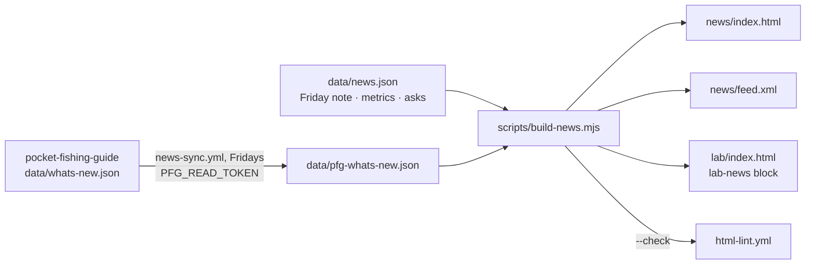

# NEWS AND UPDATES

The public record of what the lab ships and learns: `/news/`, its RSS feed, and the "What shipped" block on `/lab/`. It borrows two things from Pocket Fishing Guide: the What's new feed (one entry per change an angler or guide can see or use, newest first, each naming the part of the app it changed) and the Friday digest's founder note, which ends with one ask.

| | |
|---|---|
| Page | `/news/` (indexed, in the sitemap, strict SEO checks) |
| Feed | `/news/feed.xml` (RSS 2.0: issues and release days, 20 items) |
| Lab block | `/lab/`, between `<!-- lab-news:start -->` and `<!-- lab-news:end -->` |
| Data | `data/news.json` (issues, metrics, asks) and `data/pfg-whats-new.json` (snapshot of `pocket-fishing-guide/data/whats-new.json`) |
| Renderer | `node scripts/build-news.mjs`; `--check` in `html-lint.yml` |
| Sync | `.github/workflows/news-sync.yml`, Fridays 15:40 UTC and on demand, opens a draft PR |
| Status | Built 2026-10-23; the first issue carries numbers read by hand on 2026-10-22 |

---

## How it fits together

The site has no build step, so the rendered files are committed. The script is the one writer; CI fails when a rendered file is stale, the same pattern as the metrics function's committed sample payload.

---

## The weekly loop (Friday)

| Step | Who | What |
|------|-----|------|
| 1 | `news-sync.yml` | Fetches the What's new snapshot, rebuilds, opens or updates a draft PR on `chore/news-sync-<date>` |
| 2 | Corey (or Claude, drafted for Corey) | Writes this week's issue at the top of `issues` in `data/news.json`: `title`, `summary`, `note.lines`, `observations`, `ask`, `twt_updates`. Borrow the digest's founder note where it fits and say so in `note.source` |
| 3 | Corey | Refreshes `metrics` from the sources below, sets `as_of` |
| 4 | Anyone | `node scripts/build-news.mjs`, then the checks, then read the page at phone width |
| 5 | Corey | Reviews and merges the PR; Pages deploys |

A week with nothing to say gets no issue. The sync PR still refreshes the lab block.

### Where the numbers come from

| Metric | Source | How to read it |
|--------|--------|----------------|
| Visitors and pageviews per week, referrers, routes | Vercel Web Analytics, project `pfg`, team Tale Waters and Tides | Vercel dashboard, or the `metrics` Edge Function once its secrets are set (`docs/METRICS-DASHBOARD.md`) |
| Accounts, new in 30 days, signed in 7 days | PFG `auth.users` minus `demo_accounts` | PFG `/api/metrics/summary` with `PFG_METRICS_TOKEN`, or the SQL editor |
| Partners published, trip requests, buddy pairs, open days, invites, asks | PFG tables `partners`, `trip_requests` (source not `demo`), `connections` (accepted), `angler_open_days`, `invites`, `buddy_asks` | SQL editor, service role |
| Waters, species, condition readings, cron jobs | PFG `water_conditions`, catalog mirrors, `conditions_history`, `cron.job` | `docs/readme/CLAIMS-AUDIT-2026-10-08.md` in the PFG repo shows the method |

Rules for a number on the page:

- It carries `source` and the `as_of` date. A number without a source does not render.
- Aggregates only. Never a name, an email, a lead, a partner's private figures or anything from the TWT `leads` table.
- `show: false` keeps a metric in the file for the record without rendering it. Account totals ship with `show: false` until the owner decides; the home page's "723 users in its first 90 days" is a different measure (site users in the static-app era) and the two should not sit side by side unlabelled.
- Visitor counts include the team's own use. Vercel cannot exclude it; say so in `metrics.note`.
- Pageviews are inflated by the app's catch-all route (the PFG claims audit notes it). Lead with visitors.

### Copy rules (checked by the script)

- No exclamation marks, no stock phrases (the list mirrors `web/lib/copy-rules.ts` in the PFG repo), no bracketed placeholder copy.
- Short literal headlines. No catch counts, sizes or guarantees. A regulation line names where it came from.
- Issues newest first, dated `YYYY-MM-DD`, title at most 90 characters.

---

## Pocket Fishing Guide pictures

An entry's `image.src` is a path under `/assets/whats-new/` on www.pocketfishinguide.com; the page hotlinks it with the width, height and alt the PFG workflow wrote. Nothing is copied into this repo. If PFG moves or renames the folder, the pictures 404 and the page still reads; the sync PR is where to notice.

---

## Interlocks

| Depends on | Why it matters | Owner |
|------------|---------------|-------|
| `PFG_READ_TOKEN` secret | The PFG repo is private; without a fine-grained PAT (Contents: read, that repo only) the sync stops at the fetch step | Corey |
| "Allow GitHub Actions to create and approve pull requests" | The sync opens its PR with `GITHUB_TOKEN` | Corey |
| What's new discipline in PFG | Every PR that ships an angler-visible change adds its entry (`web/AGENTS.md`, What's new); the page is only as current as that file | PFG agents |
| Metrics refresh | Numbers are read by hand until the `metrics` function is deployed and the partner payload can feed `data/news.json` | Corey |
| License | PFG source is proprietary; only the angler-facing What's new text, already public at `/whats-new`, is mirrored here | Corey |

---

## Quality gates

| Check | Command | CI |
|-------|---------|----|
| Data rules and rendered files current | `node scripts/build-news.mjs --check` | `html-lint.yml` |
| HTML lint | `npx htmlhint@1 "**/*.html" --ignore "design/**"` | `html-lint.yml` |
| SEO, links, anchors (strict for `/news/`) | `node scripts/check-site.mjs` | `html-lint.yml` |

### Manual QC before merging an issue

- [ ] Page reads whole at 390px wide: chips in one row per card, chart labels legible, no horizontal scroll
- [ ] Every "Open in the app" link opens the right surface and carries `utm_campaign=news`
- [ ] Pictures load from pocketfishinguide.com (the sandbox that builds the PR cannot reach the site; check in a browser)
- [ ] Numbers match their source for the same window; `as_of` is this week
- [ ] The Friday note's regulation or data lines name a source
- [ ] RSS validates (paste `/news/feed.xml` into a reader)

---

## Open decisions

| Decision | Default in this slice |
|----------|----------------------|
| Publish account totals? | No (`show: false`). Visitors, waters, readings, buddies, partners and trip requests are shown |
| Feed the metrics from the `metrics` Edge Function automatically? | Later: the partner payload already has the right shape; the sync job could write `metrics.series` and the tiles once `VERCEL_TOKEN` and `PFG_METRICS_TOKEN` are set on the function |
| Email the issue? | Later, through Resend from the same JSON, as the digest does; the RSS feed is the first subscription path |
| "News" in the main nav | Yes, on the five new-style pages; the legacy pages (`/projects/`, `/events/`) keep their own nav |
| One page or one URL per issue? | One page with anchors (`#issue-<date>`) while issues are few; split when the archive passes a screen of entries |
